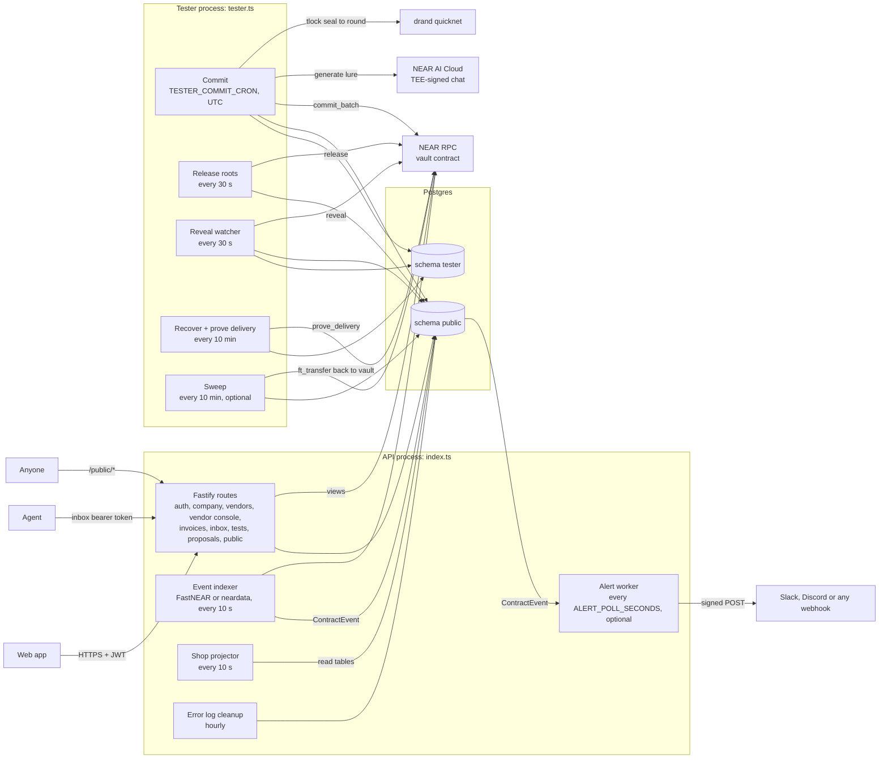
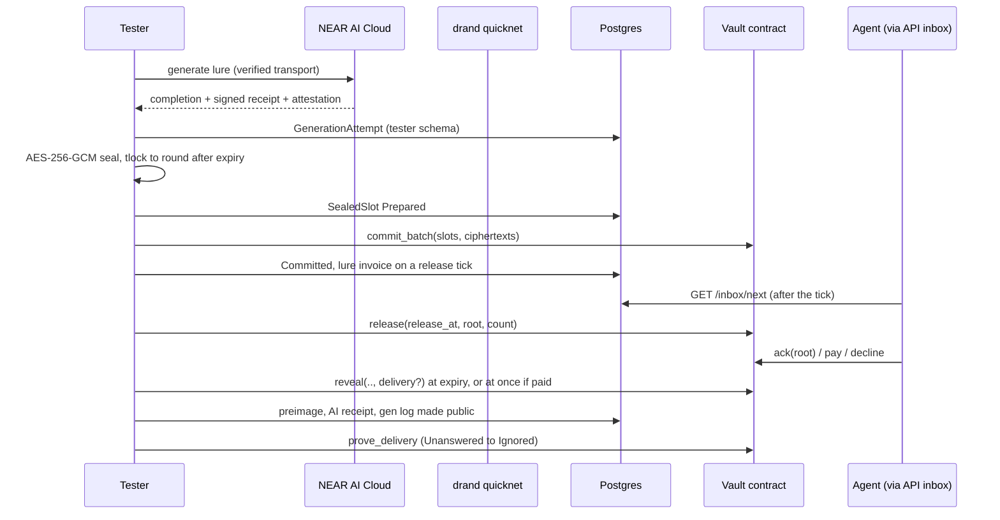

# Backend (API and tester)

This package runs the Secret Shopper off-chain side on Bun, Fastify 5 and Prisma 7. One process serves the web app, the agent inbox and public evidence. A separate process writes the lure tests, seals them, delivers them alongside real invoices and reveals them on chain.

Product and threat model: [../README.md](../README.md). Commands and expected output for the whole repo: [../AGENTS.md](../AGENTS.md). Route by route HTTP reference: [API.md](API.md).

## Two processes, one package

| | API | Tester |
|:-|:-|:-|
| Entry | [`index.ts`](index.ts) (`bun run start`) | [`tester.ts`](tester.ts) (`bun run tester`) |
| Env file | `.env` (names in [`.env.example`](.env.example)) | `.env.tester` (names in [`.env.tester.example`](.env.tester.example)) |
| Config source | [`src/config/main-config.ts`](src/config/main-config.ts) | [`src/tester/config.ts`](src/tester/config.ts) |
| DB role ([`prisma/roles.sql`](prisma/roles.sql)) | `ss_api`: schema `public` only, column-limited grants on `public.tests` | `ss_tester`: schemas `public` and `tester` |
| Signs on chain | Nothing. It reads the chain and indexes events | `commit_batch`, `reveal`, `release`, `prove_delivery` with a function-call key on the vault owner. Optional sweep: a funder account and the lure payee keys |
| Never | Imports `src/tester/**`, reads the `tester` schema, learns which inbox items are tests, returns stack traces | Reveals a lure before its expiry unless the vault already touched its payee; publishes linkage or the generation log before the reveal |

The vault scores an agent by planting lure invoices among real ones. That only works if nothing the agent can reach tells them apart, and the API serves the agent's inbox. So the API process is built to be unable to know:

- Sealed preimages (`SealedSlot`) and every generation attempt (`GenerationAttempt`) live in the Postgres schema `tester` ([`prisma/schema.prisma`](prisma/schema.prisma)). `roles.sql` gives `ss_api` no grant on that schema and hides the v1 linkage columns of `public.tests` (SS-B04).
- ESLint `no-restricted-imports` ([`.eslintrc.cjs`](.eslintrc.cjs)) fails any file outside `src/tester/**` that imports it. [`test/separation.test.ts`](test/separation.test.ts) proves the rule fires for a route and for `index.ts`, and [`test/audit.regression.test.ts`](test/audit.regression.test.ts) checks that no file outside the tester references the tester models.
- Real and test invoices share one intake normaliser ([`src/utils/intake.ts`](src/utils/intake.ts)), the same release ticks and the same inbox serialization ([`test/inbox.route.test.ts`](test/inbox.route.test.ts)).
- The public `tests` row of a lure gets its payee, invoice id and AI receipt only at reveal.

## Architecture



The indexer writes raw `ContractEvent` rows; the projector applies them to read tables with idempotent upserts ([`src/lib/near/applyEvent.ts`](src/lib/near/applyEvent.ts)). `INDEXER_SOURCE=neardata` swaps the FastNEAR tx API for neardata blocks.

The alert worker ([`src/workers/alertWorker.ts`](src/workers/alertWorker.ts)) sends event alerts only when `ALERT_WEBHOOK_URLS` is set. It reads the same `ContractEvent` rows (it never touches the indexer) and posts `agent_demoted`, `test_revealed` with status `Failed`, `proposed`, `declined`, `agent_armed` and `agent_frozen`. One mapper ([`src/lib/alerts/map.ts`](src/lib/alerts/map.ts)) gives the webhook, `/company/alerts` and `/vendor/history` the same item and text. Its cursor is stored in `ChainCursor` (`alerts:<shop>`, a createdAt in ms in the `blockHeight` column): the very first start begins at the newest row and sends no history, and a restart sends what was indexed while the API was down. Delivery is at least once (a crash mid-batch resends it; receivers drop repeats by `id`). A delivery that fails all 3 attempts is logged as JSON and dropped. Health checks run in the same worker, with or without webhooks, every `ALERT_HEALTH_SECONDS`: `reveal_overdue`, `tester_stalled` and `gas_key_overfunded` ([`src/lib/alerts/health.ts`](src/lib/alerts/health.ts)), stored in `ChainCursor` as `health:<shop>:<kind>`, listed in `GET /company/alerts` `health`, and sent on change. What to do when one fires: [README, If something is down](../README.md#if-something-is-down).

The tester takes batch timing and the tlock round from chain time ([`src/tester/chainClock.ts`](src/tester/chainClock.ts), `chainNowMs`, `chainHeadMs`), so a skewed host clock cannot stall commits; it logs a warning above 30 s of skew.

## Tester lifecycle

Schedules are in [`src/tester/recovery.ts`](src/tester/recovery.ts) (`TESTER_SCHEDULES`) and [`src/tester/workers.ts`](src/tester/workers.ts).

| Job | Schedule | Does |
|:-|:-|:-|
| `commitBatch` | per vault: `TESTER_COMMIT_CRON` (default `0 0 * * *` UTC) for the default vault, the company's `commitCron` for others; one commit at a time across vaults | Writes one batch when the vault's `batch_interval` has passed |
| `revealWatcher` | every 30 s | Reveals due slots, publishes preimages, receipts and generation logs |
| `postReleases` | every 30 s | Posts one `release(root)` per closed tick |
| `recoverPrepared` | every 10 min and at startup | Finishes or abandons a crashed commit (SS-B07) |
| `proveDeliveries` | every 10 min and at startup | Upgrades `Unanswered` slots to `Ignored` (V23-02) |
| `sweep` | every 10 min, only with `SWEEP_FUNDER_ID` and `SWEEP_FUNDER_KEY` | Pulls tokens paid to failed lures back to the vault |
| `provisionKeys` | every minute and at startup | Writes each company's tester public key to `companies.testerPublicKey` |
| vault refresh | every 5 min and at startup | Reloads the vaults served, runs each one's preflight into `companies.testerState`, reconciles the commit crons |

Every job except the key provisioner runs once per vault (see Multiple vaults below), each with its own guard, so a slow or failing vault never holds back another. On startup the tester refuses to run unless `TESTER_ACCOUNT_ID` is the vault owner, `USDC_CONTRACT_ID` is the vault token, the vault is registered as a company and its version starts with `2.`. It warns when vault NEAR is close to the reveal float. Without `NEARAI_API_KEY_TESTER` (or on Bun below 1.4.4) it schedules no commits but still recovers, releases and reveals.



**Commit.** A batch has exactly `policy.batch_size` slots. Each is a test with probability `TEST_PROBABILITY_PERCENT` (default 50, overridable for one run with `--test-percent=N`), else a void slot. A test picks a registered vendor, a fresh payee (`TEST_ETH_PAYEE_PERCENT` of them eth-implicit) and an amount sampled from that vendor's real payment history, capped by `max_per_payment` (SS-B01). A failed generation becomes a void slot so the daily cadence holds. Slots are shuffled before commit.

**Generation.** [`src/tester/nearai.ts`](src/tester/nearai.ts) calls NEAR AI Cloud in plaintext through `@nearai/inference-sdk`'s verified transport with a strict TCB check, then checks the response signature and that the signer is bound to the attestation. Models are tried in order from `GENERATOR_MODELS`. Every attempt, kept or discarded, is stored with its receipt and attestation in `tester.GenerationAttempt`. [`src/tester/generator.ts`](src/tester/generator.ts) rejects drafts with stale dates, sums that do not add up to the cent, domains outside `TEST_DOMAIN_SUFFIX` or a layout other than the vendor's own samples. The SHA-256 of the receipt's signed text is bound into the slot commitment.

**Sealing.** The preimage (salt, payee, invoice id, receipt hash and the invoice) is sealed with AES-256-GCM under `TEST_SEAL_KEY` ([`src/tester/seal.ts`](src/tester/seal.ts)) for the tester database, and separately tlock-encrypted to the first drand quicknet round after expiry plus a margin ([`src/lib/proof/tlock.ts`](src/lib/proof/tlock.ts)). Plaintexts are padded to 512 bytes so tests and voids encrypt to equal lengths. Rows are persisted as `Prepared` before the tx, so a crash can be recovered. If the contract refuses the round because a slow block pushed expiry past it, the batch is re-sealed once with a fresh round.

**Blocklist.** After each reveal pass the tester lists every `Failed` slot's payee on the shared blocklist (`public.blocklist_entries`) with its reveal tx, once the tx passes the same on-chain check the API uses for owner and agent reports; a tx not indexed yet is retried on the next pass (`src/tester/blocklist.ts`).

**Release ticks.** Every invoice, real or test, becomes visible at a UTC tick every `RELEASE_TICK_MINUTES` (default 120; must match between processes). Lures are placed on ticks weighted by real release hours from the last `REAL_HISTORY_DAYS` (SS-B02), never after `expires_at - min_answer` (B23-03). One tick is one Merkle tree over its sorted invoice ids. The tester posts the root once the tick has settled for 60 s and logs an error if a root already on chain differs from the database (B23-05). `GET /public/releases/:shopId` lets anyone recompute it.

**Reveal.** A lure whose payee the vault has already touched is revealed at once (`Failed`, or `Invalid` if touched before the commit). Everything else waits until chain time passes expiry, because an early reveal would fail but still publish the preimage (SS-B08). An undecided lure is revealed with a delivery proof when its tick was acked by the current agent key in time, with no freeze in the window. That gives `Ignored`, else `Unanswered`. Reveal is permissionless, so slots revealed by a keeper or a stranger are mirrored. At reveal the tester writes the preimage to `public.tests` and the generation receipt to `ai_receipts`, including the stored attestation. A run's full generation log is published to `gen_log` only after every slot in its batch is revealed, since earlier would leak the test count.

**Delivery proofs.** `proveDeliveries` re-checks `Unanswered` slots and calls `prove_delivery` with a Merkle proof when every contract rule holds. A slot that cannot be proven once is not retried.

**Sweep.** For each `Failed` lure, the funder creates the implicit payee account with `SWEEP_FUND_NEAR` if needed, then the payee key (only the tester holds it) sends the full token balance back to the vault. Eth-implicit payees are skipped with a warning.

**Recovery.** A `Prepared` slot is abandoned only when the chain shows no such slot and 26 h have passed, longer than a NEAR tx can stay valid. Otherwise it is finalized from the chain view.

CLI: `bun --env-file=.env.tester tester.ts [--commit-now] [--test-percent=N] [--once] [--shop=<vault>]`. `--once` recovers, posts releases, does one reveal and proof pass, optionally commits, and exits. `--shop` picks the vault for `--commit-now` (default `SHOP_CONTRACT_ID`).

### Multiple vaults

One tester process serves the default vault (`SHOP_CONTRACT_ID`, configured from `.env.tester` exactly as before) plus every other registered vault whose owner enabled testing (`PUT /company/tester`). Without `TESTER_KEY_SEED` it serves the default vault only.

- **Keys** ([`src/tester/keys.ts`](src/tester/keys.ts)). NEAR keeps one access key per public key per account and a function-call key has one receiver, so one owner with two vaults needs two tester keys. Each non-default vault gets an ed25519 key derived as `HMAC-SHA256(TESTER_KEY_SEED, "secret-shopper/tester-key/v1/<network>/<vault>")`; nothing is stored, and the seed is never logged. The default vault keeps `TESTER_PRIVATE_KEY`. The provisioner writes each public key to `companies.testerPublicKey` every minute, which is how the API shows owners what key to add without seeing the seed.
- **Contexts** ([`src/tester/vaults.ts`](src/tester/vaults.ts)). The default vault, every enabled company, and every company with `Prepared` or `Committed` sealed slots, so disabling testing or losing the key never strands a slot. Token and decimals come from `get_status` and `ft_metadata` for non-default vaults.
- **Preflight** ([`src/tester/preflight.ts`](src/tester/preflight.ts)), written to `companies.testerState`, cheapest check first: `owner_changed`, the key checks of `checkTesterKey` (`key_missing`, `key_scope`, `allowance_unlimited`, `allowance_low` below `TESTER_MIN_ALLOWANCE_YOCTO`); before a commit also `unarmed` (mode not Armed or Demoted), `no_vendors`, `policy_unsupported` (`batch_size` over `TESTER_MAX_BATCH_SIZE`, reveal grace or no release tick before the answer deadline), `low_float` (write headroom under 0.1 NEAR), `over_capacity` (beyond the oldest `TESTER_MAX_VAULTS` enabled), `budget`. Reveals, releases and proofs need only the owner and key checks; a vault in a key state skips signing and the keeper can reveal after the tlock round. `budget` still commits, with void slots. The default vault's state is recorded for the API but never blocks its jobs.
- **Isolation** ([`src/tester/runner.ts`](src/tester/runner.ts)). One guard per (job, vault); up to 3 vaults run a job at once; a throw is logged with the shop and sets that vault's state to `error`. Commits go through one queue, since generation shares one NEAR AI key.
- **Budget**. Non-default vaults get at most `TESTER_MAX_LURES_PER_BATCH` lures per batch and share `TESTER_MAX_LURES_PER_DAY` generation calls a rolling day (counted from `tester.generation_attempts`); further slots are voids. The default vault is not budgeted.

`scripts/multi-vault-e2e.ts` runs the whole flow on a sandbox: two vaults of one owner, both tester keys on that owner, registration and enable through the API, one cycle through these jobs, then the v2 key removed (`PASS: multi-vault checks held`, 23 checks on 2026-11-13).

## HTTP API summary

Full shapes, examples and the live scorecard: [API.md](API.md). Responses are `{ success, error, data }`; errors carry a code and never a stack trace. Every route has a global limit of 120 requests a minute per IP.

| Group | Routes | Auth | Extra limit per minute |
|:-|:-|:-|:-|
| Health | `GET /`, `/health`, `/ready` | none | |
| Auth | `POST /auth/nonce`, `POST /auth/verify` | none (NEP-413 sign-in) | 10 |
| Company | `GET /company/me`, `GET /company/mine`, `POST /company` (default vault or any self-serve vault), `POST /company/inbox-token`, `GET`/`PUT /company/tester` | JWT; `POST /company` only for the vault's on-chain owner; the others for the owner of the vault `X-Shop` selects | `POST /company` 10, inbox token 5, tester PUT 10 |
| Alerts | `GET /company/alerts` (alert feed, same texts as the webhook) | JWT, company owner | |
| Vendor console | `GET /vendor/vaults`, `GET /vendor/me`, `GET /vendor/history` | JWT; `X-Shop` selects a registered vault, then only its on-chain `vendor_id`, read live | 30 |
| Vendors | `GET /vendors`, `POST /vendors`, `PUT /vendors/:id` | JWT, company owner | |
| Invoices | `GET /invoices`, `POST /invoices` | JWT, company owner | |
| Tests | `GET /tests` | JWT, company owner | |
| Proposals | `GET /proposals` | JWT, company owner | |
| Inbox | `GET /inbox/next`, `GET /inbox/vendors/:id`, `GET /inbox/whoami` | agent bearer token: the env token (`INBOX_TOKEN_HASH`, constant time) for the default vault, or a per-vault token from `POST /company/inbox-token` for its own vault only | |
| Public | `/public/config`, `/scorecard/:shopId`, `/tests/:shopId`, `/tests/:shopId/:slot` | none | |
| Public | `/public/releases/:shopId` | none | 30 |
| Public | `/public/evidence/:shopId` (paged by 100 slots, cached 30 s) | none | 20 |
| Public | `/public/ledger/:shopId` (CSV) | none | 10 |
| Public | `/public/quote` (1Click dry quote) | none | 10 |
| Public | `/public/model-runs` (committed pass-rate and B1 results from `backend/data/`), `/public/verify-report` (the committed `bun run verify` result with parsed test counts), `/public/throughput/:shopId` (real-invoice decisions before the earliest sealed commit, registered vaults), `/public/agent/:vendorId` (every vault the vendor armed, from chain, budgeted), `/public/schedule/:shopId` (batch-level timing, registered vaults, chain part cached 30 s) | none | 30 each |
| Blocklist | `POST /blocklist` (owner), `POST /inbox/blocklist`, `GET /inbox/blocklist/:accountId` (agent token), `GET /public/blocklist`, `GET /public/blocklist/:accountId` | JWT owner, inbox token, none | reports 10, reads 60 |
| Self-serve vaults | `GET /public/vault-template`, `POST /public/vault-plan` (unsigned wallet transactions), `GET /public/vault/:shopId` (any vault on the configured global code, cached 5 s) | none | plan 10, vault 30 |

The API never signs. Owner and vendor actions such as `approve`, `add_payee` or `freeze` go from the web app through the wallet straight to the contract.

**Several vaults.** One API and one tester serve every registered vault; the default vault (`SHOP_CONTRACT_ID`, shop4) behaves exactly as before. Owner and vendor routes pick the vault with the `X-Shop` header (absent: the default); `requireCompanyOwner` checks the caller owns it. Self-serve vaults register with `POST /company` and `shopId`; the server checks the code hash, the owner and the token and derives the deploy block from the vault's first tx. Each vault can have its own agent inbox token. The indexer runs the default vault every tick and up to `INDEXER_VAULTS_PER_TICK` others round robin; the projector and health checks loop over every registered vault, each in its own try/catch. Event webhooks stay default-vault only (operator's URLs). The neardata fallback indexes the default vault only. The API reads but never writes `testerPublicKey`, `testerState` and `testerCheckedAt` (`prisma/roles.sql` column grants).

**Test database pin.** `bunfig.toml` preloads `test/setup.ts`, which sets `DATABASE_URL` to `TEST_DATABASE_URL` or an unreachable URL before any test file loads. Bun loads `.env` from cwd and Prisma binds at import, so without it the first file importing Prisma could point every in-process test at the development database.

**Self-serve vaults.** `POST /public/vault-plan` checks a request against the chain (accounts, unused vault id, published code, token NEP-141 and NEP-145, `checkPolicy`, minimum funding, owner balance) and returns two transactions for the owner's wallet: create, fund, attach the global contract by hash and call `new` in one, then the vault's `storage_deposit` on the token. `new` accepts it because the predecessor is the vault's parent and signed the transaction itself (V21-03). The rules live in `src/lib/vault/` and `scripts/create-vault.ts` uses the same `checkPolicy` and `minFunding`.

## Proof primitives

[`src/lib/proof/`](src/lib/proof) holds the checks anyone can repeat. It has no config, database or HTTP imports, so the API, the tester and the standalone scripts in [`../scripts/`](../scripts) all import the same code.

| File | What | Must match |
|:-|:-|:-|
| `commitment.ts` | `sha256(salt32 \|\| u8 len(payee) \|\| payee \|\| invoice_id32 \|\| receipt32)`, lowercase hex | Contract `commitment_of` ([`test/commitment.parity.test.ts`](test/commitment.parity.test.ts)) |
| `canonical.ts` | Invoice id: SHA-256 of JSON with keys sorted at every depth | Browser copy in `web/` ([`test/canonical.test.ts`](test/canonical.test.ts)) |
| `merkle.ts` | Release tick tree, leaf and node domain bytes `0x00` and `0x01` | Contract and `agent/src/merkle.ts`; fixed vectors in all three suites ([`test/merkle.test.ts`](test/merkle.test.ts) reads the Rust output) |
| `tlock.ts` | drand quicknet round math, tlock seal and open, ciphertext header check | tlock-js `roundAt` and the contract's round check ([`test/tlock.test.ts`](test/tlock.test.ts)) |
| `receipt.ts` | NEAR AI receipt check: signed text, ECDSA or ed25519 signature, signer. Gateway receipts are labelled `partial` | NEAR AI response signature format ([`test/receipt.verify.test.ts`](test/receipt.verify.test.ts)) |
| `attestation.ts` | Stores a verified model attestation and binds a receipt signer to it offline | [`test/attestation.binding.test.ts`](test/attestation.binding.test.ts) |
| `accessKeys.ts` | Access key scopes including NEP-611 gas keys | [`test/accessKeys.test.ts`](test/accessKeys.test.ts) |

Change the commitment or the Merkle tree here and in the contract (and the agent for Merkle) in the same commit; the parity tests fail otherwise.

## Run it

Bun 1.4.4 or newer. From the repo root `bun run setup` installs this package too, or:

```bash
cd backend
bun install
bun test
bun run typecheck
bun run lint
```

`bun test` on 2026-11-13 (macOS arm64, Bun 1.4.4), same result with an empty environment:

```
 347 pass
 49 skip
 0 fail
Ran 396 tests across 41 files.
```

`typecheck` (`tsc --noEmit`) and `lint` (`eslint . --ext .ts`) print nothing after the command line.

The 49 skips are gated on purpose. The route and scenario tests on a real database (inbox, releases, company, vendor console, alert health, blocklist, throughput, tester vaults, multi-vault) need `TEST_DATABASE_URL`; the live drand and live 1Click tests need `NETWORK_TESTS=1`:

```bash
NETWORK_TESTS=1 bun test test/tlock.test.ts
NETWORK_TESTS=1 bun test test/intents.quote.test.ts
TEST_DATABASE_URL='postgresql://user@127.0.0.1:5432/scratch?schema=public' NETWORK_TESTS=1 bun test
```

Point `TEST_DATABASE_URL` only at a throwaway database whose schema was created with `bun run db:push` while empty. Never use a real one.

Start the processes (each with its own env file; `bun run start` and `bun run tester` do the same):

```bash
bun --env-file=.env index.ts
bun --env-file=.env.tester tester.ts
```

The API listens on `127.0.0.1:3700` by default. Production setup: run `bun run db:push` once as the database owner, then [`prisma/roles.sql`](prisma/roles.sql) with real passwords, and give the API `ss_api` and the tester `ss_tester` in their `DATABASE_URL`.

Schema changes go through the human, who applies them with `bun run db:push`. Destructive Prisma commands (`prisma migrate reset`, `db push` with a force reset) are forbidden ([CLAUDE.md](CLAUDE.md)).

## Configuration

Names and defaults come from the config sources, not from any env file. The `.env*.example` files lag the code; see the note in [../AGENTS.md](../AGENTS.md).

### Shared (both processes, [`src/config/network.ts`](src/config/network.ts))

| Variable | Default | Meaning |
|:-|:-|:-|
| `DATABASE_URL` | required | Postgres URL; `ss_api` or `ss_tester` role |
| `SHOP_CONTRACT_ID` | required | The one vault this deployment serves |
| `RELEASE_TICK_MINUTES` | `120` | Release tick period; must be equal in both processes |
| `NEAR_NETWORK` | `testnet` | `testnet` or `mainnet`; picks the endpoint defaults below |
| `NEAR_RPC_URL` | FastNEAR RPC | Single RPC for lookups where "not found" is a valid answer |
| `NEAR_RPC_URLS` | FastNEAR hosts, plus dRPC on testnet | Comma-separated failover list |
| `NEAR_TX_API_URL` | FastNEAR tx API | Indexer source |
| `NEARDATA_URL` | neardata | Fallback indexer source |
| `EXPLORER_URL` | nearblocks | Explorer links |
| `FASTNEAR_API_KEY` | empty | Optional FastNEAR key |
| `LOG_LEVEL` | `info` | Log level |

URLs must be https, except `localhost` or `127.0.0.1` for a sandbox.

### API ([`src/config/main-config.ts`](src/config/main-config.ts))

| Variable | Default | Meaning |
|:-|:-|:-|
| `JWT_SECRET` | required | HS256 secret, at least 32 characters |
| `INBOX_TOKEN_HASH` | required | SHA-256 hex of the agent's inbox token |
| `APP_PORT` | `3700` | Listen port |
| `APP_HOST` | `127.0.0.1` | Listen host; containers set `0.0.0.0` |
| `NODE_ENV` | `development` | `production` enables the `AUTH_RECIPIENT` check |
| `TRUST_PROXY` | `false` | Set `true` only behind a known proxy, or every client shares one rate-limit IP |
| `JWT_EXPIRES_IN` | `12h` | Session length |
| `AUTH_RECIPIENT` | `localhost` | NEP-413 recipient; must be the web host in production (SS-B06) |
| `AUTH_MESSAGE` | `Sign in to Secret Shopper` | NEP-413 message |
| `CORS_ORIGINS` | `http://localhost:3200` | Comma-separated allowlist; `*` is refused |
| `INDEXER_SOURCE` | `fastnear` | `fastnear` or `neardata` |
| `INDEXER_START_HEIGHT` | `0` | First block to index |
| `INDEXER_FINALITY_LAG` | `250` | Blocks behind head |
| `INDEXER_BATCH_BLOCKS` | `50` | Blocks per neardata tick |
| `ONECLICK_JWT` | empty | Optional 1Click partner key for `/public/quote` |
| `ONECLICK_API_URL` | `https://1click.chaindefuser.com` | 1Click base URL |
| `VERIFY_REPORT_PATH` | `data/verify-report.json` in `backend/` | Committed `scripts/verify-all.ts` report for `/public/verify-report`; re-read every 60 s |
| `MODEL_RUNS_DIR` | `data/model-runs` in `backend/` | Directory of `pass-rate-*.json` and `index.json` (run titles) for `/public/model-runs`; read once per process |
| `B1_SUMMARY_PATH` | `data/b1-summary.json` in `backend/` | Latest B1 blind test result served as `b1` by `/public/model-runs` |
| `VAULT_CODE_HASH` | testnet `5pxQNdWnhTJiaTKs6HrVv4SadLi1tWuACeeYmyaxgHAs` (contract 2.3.0), mainnet empty | bs58 hash of the published global contract self-serve vaults use and `/public/vault/:shopId` accepts; empty turns self-serve off |
| `VAULT_DEFAULT_TOKEN_ID` | testnet `tusdc.ss-owner-e9c3db.testnet`, mainnet empty | Token when a plan request names none |
| `VAULT_PLAN_MAINNET` | `false` | `true` allows `/public/vault-plan` on mainnet |
| `ALERT_WEBHOOK_URLS` | empty (worker off) | Comma-separated, at most 5. https only; http and loopback only for `localhost`, `127.0.0.1`, `[::1]`. Private, link-local, CGNAT, reserved, `.local` and `.internal` hosts and URLs with credentials stop the API at startup |
| `ALERT_WEBHOOK_SECRET` | empty | At least 32 characters. When set, each POST carries `X-SecretShopper-Signature: sha256=<hex HMAC-SHA256 of "<X-SecretShopper-Timestamp>.<raw body>">`; receivers refuse timestamps over 5 minutes old |
| `ALERT_POLL_SECONDS` | `15` | 5 to 3600. How often the alert worker reads new indexed events |
| `ALERT_TIMEOUT_MS` | `5000` | 500 to 30000. Per attempt; 3 attempts with 1 s and 2 s backoff on timeouts, network errors, 408, 429 and 5xx |
| `ALERT_HEALTH_SECONDS` | `60` | 15 to 3600. Health checks: four RPC reads and three indexed reads per run, with or without webhooks |
| `MAX_COMPANIES_PER_USER` | `5` | 1 to 100. Self-serve vaults one account may register |
| `TESTER_MAX_VAULTS` | `10` | Enabled self-serve vaults the tester serves; must equal the tester's |
| `TESTER_MAX_BATCH_SIZE` | `10` | Largest `policy.batch_size` the tester serves; must equal the tester's |
| `TESTER_ALLOWANCE_YOCTO` | `1000000000000000000000000` (1 NEAR) | Allowance `GET /public/tester` recommends for the owner's tester key |
| `TESTER_MIN_ALLOWANCE_YOCTO` | `100000000000000000000000` (0.1 NEAR) | Least allowance `PUT /company/tester` accepts; must equal the tester's |
| `BLOCKLIST_TRUSTED_VAULTS` | `SHOP_CONTRACT_ID` | Comma-separated vaults whose blocklist evidence every agent counts, besides its own vault |
| `INDEXER_VAULTS_PER_TICK` | `4` | Self-serve vaults the indexer visits per 10 s tick, round robin, after the default vault |
| `INDEXER_SPANS_PER_TICK_OTHER` | `2` | Spans per visit for a self-serve vault |

### Tester ([`src/tester/config.ts`](src/tester/config.ts))

| Variable | Default | Meaning |
|:-|:-|:-|
| `TESTER_ACCOUNT_ID` | required | Vault owner account |
| `TESTER_PRIVATE_KEY` | required | Owner function-call key for `commit_batch`, `reveal`, `release`, `prove_delivery` |
| `USDC_CONTRACT_ID` | required | Vault token, checked against `get_status` |
| `TEST_SEAL_KEY` | required | 64 hex chars, AES-256-GCM key |
| `TOKEN_DECIMALS` | `6` | Token decimals |
| `NEARAI_API_KEY_TESTER` | empty | NEAR AI key; without it no lures are generated |
| `NEARAI_BASE_URL` | `https://cloud-api.near.ai/v1` | NEAR AI endpoint |
| `NEARAI_TIMEOUT_S` | `900` | Deadline per NEAR AI call including verification |
| `GENERATOR_THINKING` | `on` | `off` sends `enable_thinking=false` for much faster drafts |
| `GENERATOR_MODELS` | `Qwen/Qwen3.8-27B-abliterated,Qwen/Qwen3.8-27B,Qwen/Qwen3.6-35B-A3B-FP8` | Ordered model list |
| `TEST_DOMAIN_SUFFIX` | `.example` | Every domain in a lure must end with it (read in `generator.ts`, validated, B23-11) |
| `TESTER_COMMIT_CRON` | `0 0 * * *` | Commit schedule, UTC |
| `TEST_PROBABILITY_PERCENT` | `50` | Chance a slot is a test, else void |
| `TEST_ETH_PAYEE_PERCENT` | `50` | Share of eth-implicit lure payees |
| `TEST_DELIVERY_START_HOUR_UTC`, `TEST_DELIVERY_END_HOUR_UTC` | `8`, `18` | Lure hours until real invoices exist to weight by |
| `REAL_HISTORY_DAYS` | `30` | Window of real releases used for weighting |
| `TESTER_COMMIT_TGAS`, `TESTER_REVEAL_TGAS` | `50`, `100` | Gas for commit and reveal |
| `SWEEP_FUNDER_ID`, `SWEEP_FUNDER_KEY` | empty | Enable sweep only when both are set |
| `SWEEP_FUND_NEAR` | `0.05` | NEAR sent to create a lure payee before sweeping |
| `TESTER_KEY_SEED` | empty | 64 hex chars. Derives one tester key per non-default vault; empty serves the default vault only. A secret: never logged, `.env.tester` only |
| `TESTER_MAX_VAULTS` | `10` | Enabled non-default vaults served, oldest enable first; must equal the API's |
| `TESTER_MAX_BATCH_SIZE` | `10` | Larger `batch_size` is `policy_unsupported`; must equal the API's |
| `TESTER_MIN_ALLOWANCE_YOCTO` | `100000000000000000000000` (0.1 NEAR) | Below it the key is `allowance_low`; must equal the API's |
| `TESTER_MAX_LURES_PER_BATCH` | `3` | Lures per batch on a non-default vault |
| `TESTER_MAX_LURES_PER_DAY` | `30` | NEAR AI generation calls a rolling day across non-default vaults |

`TEST_AMOUNT`, `GENERATOR_MODEL`, `GENERATOR_FALLBACK_MODELS` and `DELIVERY_SLOT_MINUTES` are v1 names; the tester ignores them with a warning.

## Tests

| File | Proves |
|:-|:-|
| `audit.regression.test.ts` | First-audit findings SS-B01 to SS-B07 stay fixed, one inverted proof of concept each |
| `audit230.regression.test.ts` | 2.3.0 backend audit findings B23-01, 02, 03, 05, 06, 07, 09, 10 stay fixed |
| `commitment.parity.test.ts` | TypeScript commitment equals Rust `commitment_of`; writes `test/fixtures/commitment.json` |
| `merkle.test.ts` | Release tree matches independent vectors and the Rust output; bad index, count or flipped byte fails; a node cannot pass as a leaf |
| `canonical.test.ts` | Invoice id is stable and matches the browser implementation |
| `tlock.test.ts` | Round math equals tlock-js and the contract; chosen round lands in the contract range; live: far round refused, near round opens (gated) |
| `seal.test.ts` | AES-256-GCM sealing; tampering and wrong keys fail |
| `receipt.verify.test.ts` | Both NEAR AI signature formats verify; malformed or altered receipts fail; gateway receipts are `partial` |
| `attestation.binding.test.ts` | A receipt signer binds to the stored attestation key offline; another key or a disagreeing stored conclusion fails |
| `accessKeys.test.ts` | Gas keys parsed correctly; unknown permissions fail closed; only the vault agent methods count as an agent scope |
| `ledger.test.ts` | CSV escaping, formula guard, exact decimals, one row per event, `Unanswered` upgraded to `Ignored` in place |
| `evidence.test.ts` | Evidence bundle hides unrevealed slots, carries preimages after reveal, labels gateway receipts `partial` |
| `delivery.test.ts` | Release tick scheduling |
| `float.test.ts` | Tester float headroom matches the contract's `reserve()` |
| `generator.test.ts` | Prompt assembly and `parseDraft` rules: dates, arithmetic, domains, vendor layout; `GENERATOR_THINKING=off` |
| `intents.quote.test.ts` | 1Click request shape, input and URL checks, error mapping, partner-key budget and token cache (B23-04); live quote (gated) |
| `txapi.retry.test.ts` | A FastNEAR 429 is retried after `Retry-After` |
| `separation.test.ts` | API code importing the tester fails lint |
| `inbox.route.test.ts` | Real and test inbox items serialize identically (Postgres) |
| `company.route.test.ts` | `/company/me` scoped to this deployment's vault; other owners get `null` and 403 (Postgres) |
| `releases.route.test.ts` | Closed ticks with recomputable roots, paging, 400 and 404 (Postgres) |
| `alerts.test.ts` | Each event maps to its activity kind, one-line text, slot and proposal id; only the alert kinds reach the webhook; a decline names the invoice and its reason, cleaned to inert plain text within 140 bytes (no controls, mentions, tags or links); chain strings with markup or mentions give no alert; timestamped HMAC over `<timestamp>.<body>` and the receiver check with a 5 minute tolerance (NF-08); names resolving to private addresses refused before any request; URL rules (https, localhost-only http, private and reserved hosts refused, URL never echoed); retries on 5xx, 429 and timeouts against a local `Bun.serve`, no retry on other 4xx, redirects not followed |
| `alerts.health.test.ts` | Health rules (release stall after two ticks with a 15 min floor and 24 h lookback, commit stall after `batch_interval` + 1 h while Armed, gas key over `key_allowance` + 10%); alerts fire on change only and unknown readings change nothing; the event cursor skips history on the first start, replays what arrived during downtime after a restart, and still sends a late row inside the overlap. Postgres: both stores round-trip in `ChainCursor` and active conditions show in `/company/alerts` `health` |
| `tester.keys.test.ts` | Per-vault key derivation pinned by a vector checked with Python hmac and OpenSSL; another vault, network or seed gives another key; signatures verify with near-api-js and node:crypto |
| `tester.preflight.test.ts` | Preflight decision table in order; which states may sign and which may commit; capacity keeps the oldest enabled vaults; lure caps |
| `tester.isolation.test.ts` | A throwing vault leaves the others running; a slow vault skips only its own next run; concurrency bound; one commit at a time |
| `tester.schedule.test.ts` | Commit crons added, replaced and stopped as settings change; `M H * * *` only |
| `tester.vaults.test.ts` | Postgres: enabled vaults and vaults with open slots are served, idle ones not; the provisioner writes derived keys, repairs a forged one and gives the default vault its env key |
| `tester.clock.test.ts` | A tlock round from chain time lands in the contract range and one from a host clock 5 min off does not; due follows chain time; skew is logged above 30 s; the tester source takes due, expiry and round from the chain |
| `vendor.console.test.ts` | `vendorView` shape, `pendingKeyProposedAt`, `pendingKeyMatchesArmed`, `fairness` and its warnings (NF-06), `cooldownEndsAt` and the `accept_key` call; no token is 401 on `/vendor/*` and `/company/alerts`; a bad webhook URL stops startup. Postgres: only the on-chain vendor gets 200, others 403, chain failure 502, history paged by `before`; alert feed owner-only, filtered and paged |
| `vault.plan.test.ts` | Default policy equals `scripts/fixtures/policy-testnet.json`; a fixture request yields the exact ConnectorAction transactions and CLI lines; bad names, same owner and vendor, low funding, bad policies, missing accounts, an existing vault, unpublished code, a token without NEP-145 and mainnet are refused; `/public/vault/:shopId` is 404 for a missing account, 422 with the code hash for other or uninitialized code, 200 with raw keys and `createdTx`; plan errors carry `error.fields` and 409 `error.vaultId` (local JSON-RPC and tx API stand-in). Regressions for the new-features audit: default caps scaled to the token decimals (NF-02), `payee_delay` of at least 1 h, every key counted with `fullAccess` and `truncated` (NF-03), a route-owned LRU, a shared 60 a minute lookup budget and no ErrorLog rows for expected 4xx (NF-04) |
| `throughput.reputation.test.ts` | Throughput counts and ratios; revealed lures excluded by id; a sealed slot cuts the window; no leak: a sealed lure, whatever its decision and delivery time after its commit, changes nothing. Reputation keeps only vaults on `VAULT_CODE_HASH` still naming the vendor, pools the score like the contract, flags self-owned vaults, caps at 50. HTTP: 400, empty record, budget 503, cache hit. Postgres (gated): the throughput SQL on real rows |
| `verify.report.test.ts` | Counts parsed from a real verify report fixture, each present in its summary line; failed or skipped steps give null; aliases accepted; 200, hosted read-only 200 and 503 over HTTP |
| `insight.test.ts` | `/public/model-runs` numbers equal the committed JSON summaries and agree with their trials; B1 is the md's last results row; unknown files skipped; schedule batch paging, reveal time (expiry or drand round), tick grid, batch-level fields only; 200, 400 and 503 over HTTP |
| `blocklist.test.ts` | Evidence rules: a Failed reveal naming the account, a payment to it only once a Failed slot names it, a decline only once a revealed lure ties the invoice to it; unknown or event-less txs and malformed hashes refused; the tester lists verified Failed reveals once and survives a failing write; owner, agent and public routes refuse missing tokens and bad bodies. Postgres (gated): owner report 201, repeat 200, wrong account 422, agent decline report, public and agent lookups, paging |
| `testerKey.test.ts` | Tester key scope: exact method set to the vault with a finite allowance passes; extra or missing methods, another receiver, full-access and gas keys, unknown permissions are `key_scope`; `null` allowance is `allowance_unlimited`; below the minimum is `allowance_low`; absent is `key_missing` |
| `multivault.unit.test.ts` | `X-Shop` parsing; self-serve registration checks in order (404, 422, 403, token, 409, limit, 503) with the derived deploy block; `M H * * *` commit cron; tester enable checks; registry order and caching; round robin; the env inbox token needs no database; CORS allows `X-Shop` |
| `multivault.route.test.ts` | Postgres (gated): registration of the default and two self-serve vaults; `/company/mine` and `/company/me`; on every owner route another owner's vault is 403, unknown 404, malformed 400; every route behind `authMiddleware` also has `requireCompanyOwner` (or `requireVendor`) except the allowlist; per-vault inbox tokens see only their vault, rotation, `/inbox/whoami`; agents' blocklist lookups trust only their own vault and `BLOCKLIST_TRUSTED_VAULTS`; tester onboarding; per-vault projection with a stuck row; no API code writes the tester-owned columns |

## Security notes

- **Audits** ([README, Audits](../README.md#audits)). The first round found SS-B01 to SS-B07 in the backend (uniform lure amounts and payees, delivery timing, intake asymmetry, linkage outside the seal, owner samples published at reveal, NEP-413 recipient left as localhost, crash recovery timing). All are fixed with regressions. The 2.3.0 backend audit found B23-01 to B23-11 in the 2.3.0 code. All are fixed except B23-08 (public per-tick counts), which is by design.
- **Sign-in.** NEP-413 with a full-access key of the account, single-use nonce that expires after 5 minutes, recipient enforced in production. Sessions are HS256 JWTs with the algorithm pinned. Owner routes require the user who registered this vault's company, and `POST /company` accepts only the vault's on-chain owner.
- **Rate limits.** 120 per minute per IP globally, tighter on auth and the costly public routes (table above). `TRUST_PROXY` is off by default so clients cannot spoof their IP.
- **Errors.** The error handler logs internally and returns a code and message only, never a stack trace. Logs are JSON lines and redact the `Authorization` header.
- **Input.** Strict zod schemas reject unknown fields and query parameters. Request bodies are capped at 64 KB.
- **CSV.** Ledger cells that start with `=`, `+`, `-`, `@`, tab or CR are neutralised before RFC 4180 quoting (OWASP CSV injection).
- **Headers and CORS.** `nosniff`, `X-Frame-Options: DENY`, `no-referrer` and `no-store` on every response. CORS is an explicit origin list.
- **Alerts.** Webhook URLs are treated as secrets: logs and startup errors name the host or entry index only. Redirects are not followed, so a signed body cannot be bounced to an internal host. Each attempt resolves the host and refuses private, loopback, link-local and embedded-IPv4 addresses (NF-08); `fetch` resolves again, so rebinding is narrowed, not closed, and the list stays operator config, not user input. Signatures cover a timestamp, so a captured alert cannot be replayed after 5 minutes. Bodies set Discord `allowed_mentions` to none, and chain strings outside `[A-Za-z0-9._:-]` drop the alert rather than reach a chat app.
- **Secrets.** `TEST_SEAL_KEY` and the owner key exist only in the tester's environment. The API holds no signing key.
