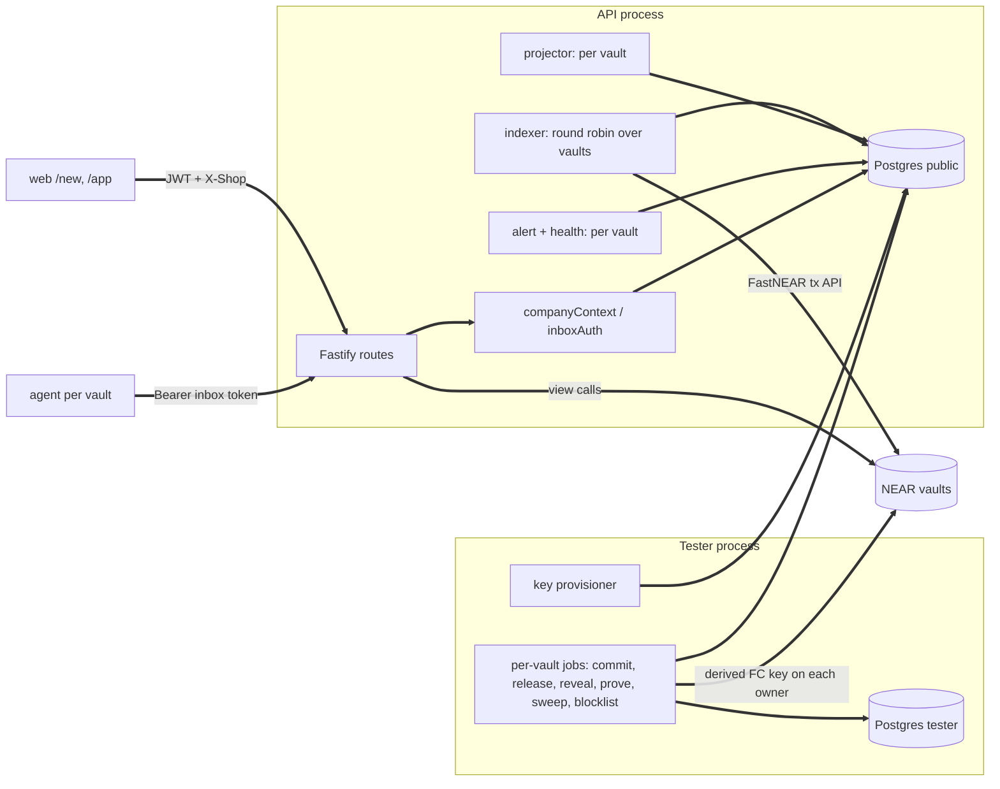

# 37. Multi-vault backend design

Status: design, not implemented. Date: 2026-11-13. Scope: `backend/` (API, workers, tester) plus a small agent check. Web changes are listed as the contract the web needs, not designed here.

## Overview

Today one API process and one tester process serve one vault (`SHOP_CONTRACT_ID`, shop4). This design lets vaults created self-serve (`POST /public/vault-plan`, web `/new`) be registered, indexed, tested and served to their own agent from the same processes and database, with shop4 as the default vault whose live flow does not change. Every change is additive: new nullable or defaulted columns on `companies`, no new tables, no data migration. When a request or job names no vault, it means `SHOP_CONTRACT_ID`, exactly as today.

One finding changes the brief. NEAR stores at most one access key per public key on an account (`AddKeyAlreadyExists`, nomicon RuntimeSpec/Actions), and a function-call key has exactly one `receiver_id` (docs.near.org/protocol/access-keys). `ss-owner-e9c3db.testnet` already holds the shop4 tester key `ed25519:4PFFPN...` with receiver shop4, so the same public key cannot be added again for `selfserve-e2e`. A single shared tester keypair therefore cannot serve two vaults of one owner. The tester instead derives one keypair per vault from one secret seed (ADR-2). shop4 keeps `TESTER_PRIVATE_KEY`.

## Component diagram



## Components

| Component | Responsibility | Package | Files |
|:-|:-|:-|:-|
| Vault registry | Cached list of registered companies for workers | A | new `src/lib/vaults.ts` |
| Registration | `POST /company` for any vault, `GET /company/mine` | A | `src/routes/companyRoutes.ts`, `src/lib/near/events.ts` |
| Vault selection | `X-Shop` header, default `SHOP_CONTRACT_ID` | A | `src/middlewares/companyContext.ts`, `src/app.ts` (CORS) |
| Inbox tokens | Per-company token, env hash fallback for shop4 | A | `src/middlewares/inboxAuth.ts`, `src/routes/inboxRoutes.ts`, `companyRoutes.ts` |
| Tester onboarding API | Public key, scope check, enable and settings | A | new `src/routes/testerRoutes.ts` |
| Tester key scope check | Pure check of `view_access_key_list` output | A (shared) | new `src/lib/proof/testerKey.ts` |
| Indexer, projector, alerts | Iterate registered vaults with isolation | A | `src/workers/*`, `src/lib/alerts/healthReads.ts` |
| Blocklist scoping | Per-vault evidence, trusted-vault filter for agents | A | `src/routes/blocklistRoutes.ts`, `src/lib/blocklist/store.ts` |
| Agent vault check | Refuse a token for another vault | A | `agent/src/inboxClient.ts`, `agent/index.ts` |
| Tester keys | Derive per-vault ed25519 keys, write public keys | B | new `src/tester/keys.ts` |
| Tester contexts | Load and preflight one `VaultCtx` per vault | B | new `src/tester/vaults.ts` |
| Tester jobs | Every job takes a `VaultCtx`; per-vault guard | B | `src/tester/workers.ts`, `src/tester/config.ts`, `tester.ts` |
| Tester schedules | Per-company commit cron, reconciled | B | new `src/tester/schedule.ts` |

## 1. Schema

### Prisma diff (`prisma/schema.prisma`, model `Company`)

```prisma
model Company {
  id              String      @id @default(cuid())
  ownerUserId     String
  name            String
  shopContractId  String      @unique // the vault account
  vendorAccountId String // agent vendor account
  deployBlock     BigInt // indexer start height
  createdAt       DateTime    @default(now())
+ createdTxHash        String? // vault creation tx (first tx it received), null for the legacy default vault
+ inboxTokenHash       String?   @unique // sha256 hex of the agent inbox token; plaintext is shown once
+ inboxTokenCreatedAt  DateTime?
+ testerEnabled        Boolean   @default(false) // owner opt-in; the default vault is tested from env regardless
+ testerEnabledAt      DateTime? // capacity order (TESTER_MAX_VAULTS)
+ testerSignerId       String? // vault owner holding the tester FC key, checked on chain at enable
+ testPercent          Int       @default(50) // per-slot test probability for this vault
+ commitCron           String? // null: TESTER_COMMIT_CRON
+ testerPublicKey      String? // written by the tester process only
+ testerState          String? // written by the tester process only: see TESTER_STATES
+ testerCheckedAt      DateTime? // written by the tester process only
  ...relations unchanged...

  @@index([ownerUserId])
+ @@index([vendorAccountId])
  @@map("companies")
  @@schema("public")
}
```

No new tables. Tester-written status lives in `public.companies` because the API must read it and may never read schema `tester` (SS-B04). Nothing written there identifies a test (section 8).

### SQL the database owner runs (Prisma DDL form)

Apply as the owner role with `psql`, not `db push` from `backend/.env`: that URL is `ss_api`, which cannot see schema `tester`, so Prisma would try to recreate the tester tables (this happened on 2026-11-12). Take a dump first, as before (`pg_dump -Fc secretshopper_dev > scratchpad/db-backup-<date>-pre-multivault.dump`), then `bunx prisma generate` in `backend/`.

```sql
ALTER TABLE "public"."companies" ADD COLUMN     "commitCron" TEXT,
ADD COLUMN     "createdTxHash" TEXT,
ADD COLUMN     "inboxTokenCreatedAt" TIMESTAMP(3),
ADD COLUMN     "inboxTokenHash" TEXT,
ADD COLUMN     "testPercent" INTEGER NOT NULL DEFAULT 50,
ADD COLUMN     "testerCheckedAt" TIMESTAMP(3),
ADD COLUMN     "testerEnabled" BOOLEAN NOT NULL DEFAULT false,
ADD COLUMN     "testerEnabledAt" TIMESTAMP(3),
ADD COLUMN     "testerPublicKey" TEXT,
ADD COLUMN     "testerSignerId" TEXT,
ADD COLUMN     "testerState" TEXT;

CREATE UNIQUE INDEX "companies_inboxTokenHash_key" ON "public"."companies"("inboxTokenHash");

CREATE INDEX "companies_vendorAccountId_idx" ON "public"."companies"("vendorAccountId");
```

Check after applying: `bunx prisma migrate diff` from the owner URL against `schema.prisma` reports no difference.

### Grants (append to `prisma/roles.sql`)

`ss_tester` already has full DML on schema `public`, so it needs nothing new. The API loses UPDATE on the three tester-written columns, which is defense in depth: the tester rewrites `testerPublicKey` from its own derivation every minute anyway (section 6).

```sql
/* Multi-vault (v2/37): the API may not rewrite tester-written columns on companies. */
REVOKE UPDATE ON public.companies FROM ss_api;
GRANT UPDATE ("name", "inboxTokenHash", "inboxTokenCreatedAt", "testerEnabled", "testerEnabledAt", "testerSignerId", "testPercent", "commitCron")
  ON public.companies TO ss_api;
```

INSERT stays table-level for `ss_api` (Prisma's insert column list is not under our control). A row inserted with a forged `testerPublicKey` is overwritten by the provisioner within a minute and the tester never signs with a key it did not derive.

### Rollback

```sql
GRANT UPDATE ON public.companies TO ss_api;
DROP INDEX IF EXISTS "public"."companies_inboxTokenHash_key";
DROP INDEX IF EXISTS "public"."companies_vendorAccountId_idx";
ALTER TABLE "public"."companies" DROP COLUMN "commitCron", DROP COLUMN "createdTxHash", DROP COLUMN "inboxTokenCreatedAt",
  DROP COLUMN "inboxTokenHash", DROP COLUMN "testPercent", DROP COLUMN "testerCheckedAt", DROP COLUMN "testerEnabled",
  DROP COLUMN "testerEnabledAt", DROP COLUMN "testerPublicKey", DROP COLUMN "testerSignerId", DROP COLUMN "testerState";
```

Then revert `schema.prisma`, run `prisma generate` and redeploy both processes. Self-serve company rows and their tests, invoices and events stay (they use existing columns). If those vaults have open slots, the keeper (`scripts/keeper.ts`) can still reveal them after their tlock round, since reveal is permissionless.

## 2. Registration

### `POST /company`

Auth: JWT. Rate limit 10 a minute. Body (strict):

```ts
{ name: string /* 1..120 */, shopId?: AccountId, deployBlock?: number | numeric string }
```

| Case | Rule |
|:-|:-|
| `shopId` absent or equal to `SHOP_CONTRACT_ID` | Legacy path, unchanged: `deployBlock` required, no code hash check (shop2 and shop3 are classic deploys) |
| Any other `shopId` | Self-serve path below; a client `deployBlock` is refused (400) because the server derives it |

Self-serve checks, in order (chain reads go through the injectable `VaultChain` from `src/lib/near/vaultChain.ts` so tests need no RPC):

1. `readVault(vaultChain, shopId, VAULT_CODE_HASH)` must return `kind: 'vault'`: the account exists, `global_contract_hash == VAULT_CODE_HASH`, and `new` has run. `missing` is 404, `foreign` is 422 `NOT_A_VAULT`. This also pins version 2.3.0.
2. `status.owner_id === request.user.walletAddress`, else 403.
3. `view(status.token_id, 'ft_metadata')` parses (symbol, decimals 0..38), else 422 `TOKEN_UNSUPPORTED`. The tester needs decimals per vault.
4. `policy.batch_size <= TESTER_MAX_BATCH_SIZE` (10) is not required to register, only to enable testing (section 6).
5. Not already registered: `findUnique({ shopContractId })` is 409, and a Prisma `P2002` on create (concurrent registration) is also 409.
6. The user has fewer than `MAX_COMPANIES_PER_USER` (5) companies, else 409 `COMPANY_LIMIT`.
7. `deployBlock` derivation: new `firstReceivedTx(accountId)` in `src/lib/near/events.ts` returns `{ hash, blockHeight }` from FastNEAR `/v0/account` with `is_receiver: true, desc: false, limit: 1` (the same call as `firstIncomingTxHash`, also reading `tx_block_height`). For a vault built by the plan that is its creation tx, since a vault holds no keys and never signs. Store `deployBlock = blockHeight - 1` (one block of margin whatever the tx API's range inclusivity) and `createdTxHash = hash`. No row yet (tx API lag right after creation) is 503 `VAULT_NOT_INDEXED`, retry in a few seconds. A tx API failure is 502. A client-supplied block is never trusted for a self-serve vault: too high silently loses events.

Response 201:

```json
{ "success": true, "error": null, "data": {
  "id": "cm...", "name": "Acme", "shopContractId": "selfserve-e2e.ss-owner-e9c3db.testnet",
  "vendorAccountId": "vendor.testnet", "deployBlock": "277912345", "createdTxHash": "5dga...",
  "createdAt": "2026-11-13T10:00:00.000Z", "isDefault": false,
  "tester": { "enabled": false, "testPercent": 50, "commitCron": null, "publicKey": null, "state": null },
  "inboxTokenSet": false } }
```

`registry.invalidate()` (section 5) runs after the insert so workers pick the vault up at once.

### `GET /company/mine`

Auth: JWT. `{ items: CompanyView[] }`, every company whose `ownerUserId` is the caller, oldest first, same shape as above. Never includes `inboxTokenHash`.

### `GET /company/me`

Unchanged contract: with no `X-Shop` it returns the caller's company for `SHOP_CONTRACT_ID` or `null`, as `company.route.test.ts` asserts today. With `X-Shop` it returns the caller's company for that vault or `null`. Same `CompanyView` shape (new fields are additions).

## 3. Owner-route scoping

### Recommendation: `X-Shop` header (ADR-1)

`X-Shop: <vault account id>` on any owner or vendor route; absent means `SHOP_CONTRACT_ID`. A query parameter would have to be added to every strict zod query schema and to POST bodies, and would end up in access logs and browser history; a header touches one middleware. CORS `allowedHeaders` in `src/app.ts` becomes `['Content-Type', 'Authorization', 'X-Shop']`. Every owner request already preflights because of `Authorization`, so this costs nothing.

### `requireCompanyOwner` (`src/middlewares/companyContext.ts`)

```ts
export const shopFromRequest = (request: FastifyRequest): { ok: true; shop: string } | { ok: false } // header parsed with accountIdSchema
export const requireCompanyOwner: preHandler
// 1. header absent: SHOP_CONTRACT_ID; malformed: 400 VALIDATION_ERROR
// 2. company by shopContractId: none is 404 COMPANY_NOT_FOUND
// 3. ownerUserId !== request.user.id: 403
// 4. request.company = { id, shopContractId, ownerUserId, vendorAccountId, isDefault }
```

404 versus 403 reveals whether a vault is registered, which `GET /public/vault/:shopId` already publishes, so no new leak.

### Routes that change

| Route | Change |
|:-|:-|
| `GET /company/me` | Honors `X-Shop` (section 2) |
| `POST /company` | Section 2 |
| `GET /company/mine` | New |
| `GET /company/alerts` | `alertWhere(shop)` becomes a function; `alertToken`, `toActivity` context and `healthStore` use `request.company.shopContractId` |
| `POST /company/inbox-token` | New (section 4) |
| `GET /company/tester`, `PUT /company/tester` | New (section 6) |
| `GET /invoices` | `getDecision(request.company.shopContractId, ...)` instead of `SHOP_CONTRACT_ID` |
| `POST /invoices`, `GET/POST/PUT /vendors`, `GET /tests`, `GET /proposals` | No code change: already filter by `request.company.id`; they get scoping through the middleware |
| `POST /blocklist` | `evidenceReads(request.company.shopContractId)` per request (today a module constant) and `vault: request.company.shopContractId` |
| `GET /vendor/me`, `GET /vendor/history` | `X-Shop` selects the vault; `requireVendor` first requires a registered company for it (not an open RPC proxy), then `status.vendor_id === wallet`. `VendorChain` methods take `shop`; caches key on it |
| `GET /vendor/vaults` | New: `{ items: [{ shopContractId, name }] }` for companies whose `vendorAccountId` is the caller (a hint; every vendor route re-checks `get_status` live) |
| `GET /public/config`, `GET /public/quote` | Unchanged, default vault |

`/public/*` routes keyed by `:shopId` (scorecard, tests, tests/:slot, releases, evidence, ledger, schedule, throughput) already look the company up by `shopContractId` and become per-vault automatically once a vault is registered.

## 4. Agent inbox per vault

### Token issue: `POST /company/inbox-token`

Auth: JWT + `requireCompanyOwner` (`X-Shop`). Rate limit 5 a minute. No body. Generates `token = 'ssi_' + base64url(randomBytes(32))`, stores `inboxTokenHash = sha256hex(token)` and `inboxTokenCreatedAt = now()`, and returns `201 { token, shopContractId, createdAt }` once. Calling again rotates: the old token stops working at once. The token is never logged (`request.log` gets the shop only) and `Authorization` is already redacted.

### `inboxAuth` (`src/middlewares/inboxAuth.ts`)

```ts
declare module 'fastify' { interface FastifyRequest { inboxCompany?: { id: string; shopContractId: string } } }
// 1. hash = sha256(bearer); empty bearer: 401
// 2. company = findUnique({ inboxTokenHash: hex(hash) }): found, set request.inboxCompany
// 3. else timingSafeEqual(hash, INBOX_TOKEN_HASH): company of SHOP_CONTRACT_ID (may be null: 200 null as today for /next)
// 4. else 401 INBOX_UNAUTHORIZED
```

The lookup is by a sha256 of a 256-bit random token through a unique index, so its timing tells an attacker nothing they can use. `INBOX_TOKEN_HASH` stays required in `main-config.ts` for shop4.

### Inbox routes scoped to `request.inboxCompany`

| Route | Change |
|:-|:-|
| `GET /inbox/next` | `companyId: request.inboxCompany.id`; drop the module `companyId()` helper |
| `GET /inbox/vendors/:id` | Same scoping; a vendor id of another company is 404 |
| `POST /inbox/blocklist` | Reporter `agent:<shop>`, evidence read on that shop, `vault: shop` |
| `GET /inbox/blocklist/:accountId` | Trusted-vault filter (section 7) |
| `GET /inbox/whoami` | New: `{ shop }`, so the agent can refuse a token for another vault |

### Agent (`agent/`)

`createInbox` gains `whoami(): Promise<{ shop: string }>`. `agent/index.ts` calls it at startup and exits with a clear error when `shop !== AGENT_VAULT_ID`; a 404 (older API) logs a warning and continues. The agent still has no database URL and needs no new config: an owner gives their agent `INBOX_TOKEN=<plaintext>` and `AGENT_VAULT_ID=<vault>`.

## 5. Indexer and projector per vault

### Vault registry (`src/lib/vaults.ts`, new)

```ts
export interface RegisteredVault { companyId: string; shop: string; deployBlock: bigint; isDefault: boolean; testerEnabled: boolean }
export const registry: { list(): Promise<RegisteredVault[]>; invalidate(): void } // cached 30 s; default vault first
```

### FastNEAR indexer (`src/workers/nearEventIndexer.ts`)

- `startHeight(cursorId, shop)` takes the shop; falls back to that company's `deployBlock`, then `INDEXER_START_HEIGHT` for the default vault only.
- Cursor ids stay `events:<shop>`, so shop4's existing cursor row is reused untouched.
- Each tick (every 10 s): the default vault with up to `INDEXER_SPANS_PER_TICK` (10) spans as today, then up to `INDEXER_VAULTS_PER_TICK` (new, default 4) other vaults picked round robin (in-memory pointer), each with up to `INDEXER_SPANS_PER_TICK_OTHER` (new, default 2) spans. Each vault is its own try/catch; one failing vault logs `{ shop }` and the loop continues.
- Budget: a caught-up vault costs one `/v0/account` call per visit (plus `ceil(txs/20)` `/v0/transactions` calls when it has new txs). With 20 self-serve vaults and the defaults, each is visited every 50 s and the indexer makes about 0.5 tx API calls a second, the same order as today's single vault at 0.1 a second. `postTxApi` already honors 429 Retry-After.
- Backfill: a new vault starts at `deployBlock`, at most minutes old for a fresh self-serve vault, so it catches up in one visit.

### neardata fallback (`src/workers/eventIndexerNeardata.ts`)

Stays default-vault only (`neardata:<SHOP_CONTRACT_ID>`) and logs once that other vaults are not indexed in this mode. A multi-vault block scan needs a shared block cursor and a contract set filter; not worth it for a fallback in one day.

### Projector (`src/workers/shopProjector.ts`)

For each registered vault: `findMany({ contractId: shop, projectedAt: null, take: 500 })` then `applyEvent(companyId, shop, ev)`. Per-vault `take` means a vault with rows stuck on a later dependency cannot starve another. Per-vault try/catch.

## 6. Tester per vault

### Keys (ADR-2), `src/tester/keys.ts`

```ts
// seed32 = HMAC-SHA256(TESTER_KEY_SEED, `secret-shopper/tester-key/v1/${network}/${vaultId}`)
export const testerKeyFor = (seed: Buffer, network: string, vaultId: string): KeyPair
// ed25519 public key from seed32 via @noble/curves ed25519.getPublicKey (add @noble/curves as a direct dependency);
// KeyPair.fromString(`ed25519:${baseEncode(concat(seed32, pub))}`)
```

- `TESTER_KEY_SEED`: new, 64 hex chars, tester env only. Unset means only the default vault is served (exactly today's behavior).
- Default vault: `TESTER_PRIVATE_KEY` signed as `TESTER_ACCOUNT_ID`, unchanged.
- Deterministic: no secret storage, survives database loss, and each vault gets its own nonce lane so vaults sign in parallel safely.

### Key provisioner (tester job, every minute)

For every registered non-default company: derive the key; if `testerPublicKey` differs, write it (log `tester_key_written` or `tester_key_mismatch_fixed`). For the default company write the public key of `TESTER_PRIVATE_KEY`. This is how the API learns public keys without ever touching the seed.

### Shared scope check (`src/lib/proof/testerKey.ts`, package A delivers first, both use it)

```ts
export const TESTER_METHODS = ['commit_batch', 'prove_delivery', 'release', 'reveal'] as const; // sorted
export type TesterKeyCheck =
  | { ok: true; allowanceYocto: bigint }
  | { ok: false; code: 'key_missing' | 'key_scope' | 'allowance_unlimited' | 'allowance_low' };
/** keys: view_access_key_list of the owner. Exactly a FunctionCall key to vaultId with exactly TESTER_METHODS and a finite allowance. */
export const checkTesterKey = (keys: AccessKeyEntry[], publicKey: string, vaultId: string, minAllowanceYocto: bigint): TesterKeyCheck;
export const TESTER_STATES = ['ok', 'provisioning', 'key_missing', 'key_scope', 'allowance_unlimited', 'allowance_low', 'owner_changed',
  'unarmed', 'no_vendors', 'policy_unsupported', 'low_float', 'over_capacity', 'budget', 'error'] as const;
```

Uses `keyScope` from `src/lib/proof/accessKeys.ts`; `FullAccess`, `GasKey*` and unknown permissions are `key_scope` (fail closed). An unlimited (`null`) allowance is refused: a leaked seed would otherwise let an attacker burn every owner's whole balance on gas.

### Onboarding routes (`src/routes/testerRoutes.ts`, package A)

`GET /public/tester/:shopId` (registered vaults only, 30 a minute):

```json
{ "shopId": "selfserve-e2e.ss-owner-e9c3db.testnet", "signerId": "ss-owner-e9c3db.testnet",
  "publicKey": "ed25519:..." , "receiverId": "selfserve-e2e.ss-owner-e9c3db.testnet",
  "methods": ["commit_batch", "prove_delivery", "release", "reveal"],
  "allowanceYocto": "1000000000000000000000000", "minAllowanceYocto": "100000000000000000000000",
  "enabled": false, "state": "provisioning" }
```

`publicKey: null` with `state: 'provisioning'` until the provisioner runs (at most a minute). `signerId` is the company's on-chain owner (`get_status.owner_id`, cached 60 s). `allowanceYocto` is the recommendation `TESTER_ALLOWANCE_YOCTO` (API config, default 1 NEAR: about a week of default-policy traffic, see Risks). Everything here is public on chain once the key is added.

The web builds the owner's transaction itself (trust rule from the 2026-11-13 web audit): signer and receiver the owner, one `AddKey` action with `FunctionCall { receiver_id: shopId, method_names: TESTER_METHODS, allowance }`. `@hot-labs/near-connect` types include `AddKey`. CLI fallback, the same form as the web's other CLI paths: `near account add-key <owner> grant-function-call-access` with the allowance, contract account id and function names, `use-manually-provided-public-key <pk>`, `network-config testnet sign-with-legacy-keychain send`.

`GET /company/tester` (owner, `X-Shop`): the same object plus `testPercent`, `commitCron`, `testerCheckedAt`.

`PUT /company/tester` (owner, `X-Shop`, 10 a minute), body strict:

```ts
{ enabled: boolean, testPercent?: number /* int 0..100 */, commitCron?: string | null }
```

- `commitCron`: `M H * * *` only (regex `^([0-5]?\d) ([0-9*,/-]+) \* \* \*$` plus `cron.validate`), so it fires at most hourly. The contract's `batch_interval` still decides when a batch is due.
- `enabled: true` requires, else 422 with `code`: `testerPublicKey` set (`provisioning`); `checkTesterKey` on `vaultChain.accessKeys(status.owner_id)` is ok; at least one vendor row; `policy.batch_size <= TESTER_MAX_BATCH_SIZE`; fewer than `TESTER_MAX_VAULTS` (default 10) enabled non-default companies, else 409 `TESTER_FULL`. It then sets `testerEnabled = true`, `testerEnabledAt = now()`, `testerSignerId = status.owner_id`.
- `enabled: false` stops new commits only. Open slots are still revealed (below).
- The default vault refuses `PUT` with 409 `DEFAULT_VAULT_ENV`: its tester settings stay in `.env.tester`.

### Tester contexts (`src/tester/vaults.ts`)

```ts
export interface VaultCtx {
  companyId: string; shop: string; isDefault: boolean;
  signerId: string; chain: TesterChain; sweep: Sweeper | null;
  tokenId: string; decimals: number; testPercent: number; commitCron: string;
  evidence: EvidenceReads; posted: Set<string>; noProof: Set<number>; // per-vault state that is module-level today
}
export const loadContexts: () => Promise<VaultCtx[]> // every 5 min and at startup
export const preflight: (ctx: VaultCtx, forCommit: boolean) => Promise<TesterState> // writes testerState, testerCheckedAt
```

`loadContexts` takes the default vault (from env, always), every company with `testerEnabled`, and every company with `Prepared` or `Committed` rows in `tester.sealed_slots` (so disabling or losing the key never strands a sealed slot). `Account` objects are cached per shop. `tokenId` comes from `get_status`; `decimals` from `ft_metadata` (cached 1 h), replacing `USDC_CONTRACT_ID` and `TOKEN_DECIMALS` for non-default vaults; the default vault keeps its env cross-check.

`preflight` per run, cheapest first: `get_status.owner_id === signerId` (`owner_changed`); `checkTesterKey` on the owner's key list with `TESTER_MIN_ALLOWANCE_YOCTO` (0.1 NEAR); for commits also: mode `Armed` or `Demoted` for non-default vaults (`unarmed`; no NEAR AI spend on an agent that cannot act), vendors (`no_vendors`), `batch_size`, `assertRevealGrace` and the release-tick check (`policy_unsupported`), `writeHeadroom >= 0.1 NEAR` (`low_float`; a commit would fail on chain under V2-09 and burn allowance), capacity (`over_capacity`, oldest `testerEnabledAt` first) and budget (`budget`). Reveal, release and prove jobs need only the first two; a vault in `key_missing` skips signing and the keeper reveals after the tlock round.

### Jobs (`src/tester/workers.ts`)

Every exported job becomes `(ctx: VaultCtx) => Promise<void>`: `recoverPrepared`, `commitBatch(ctx, { testPercent })`, `postReleases`, `proveDeliveries`, `revealWatcher` (then `publishGenLogs` and `blocklistFailed` for the same ctx), `sweep`. Module-level `SHOP`, `companyId()`, `posted`, `noProof`, `commitOptions` and the single `createTesterChain` / `createSweeper` go away; the bodies are otherwise unchanged and already filter by `cid`. `realReleaseHistory`, `deliveryFor`, `finalize` take the ctx.

Runner:

```ts
// One guard per (job, shop): a slow vault skips only its own next run. Concurrency 3 across vaults.
export const forEachVault = (name: string, job: (ctx: VaultCtx) => Promise<void>) => async (): Promise<void>;
```

Every per-vault call is wrapped in try/catch that logs `{ job, shop, ...errFields }` and sets `testerState = 'error'`; nothing one vault throws reaches another.

Schedules (`src/tester/schedule.ts`): reveal, release, recover, prove and sweep keep `TESTER_SCHEDULES` and fan out with `forEachVault`. Commits: one `node-cron` task per ctx on `ctx.commitCron` (default vault: `TESTER_COMMIT_CRON`), reconciled every 5 minutes (add, replace on change, stop on disable). Commits run through a single global queue (concurrency 1): generation is the bottleneck (150 to 300 s per reasoning draft) and shares one NEAR AI key.

Generation budget (non-default vaults only; the default vault is unchanged):

| Setting | Default | Effect |
|:-|:-|:-|
| `TESTER_MAX_LURES_PER_BATCH` | 3 | Further slots in a batch are voids |
| `TESTER_MAX_LURES_PER_DAY` | 30 | Counted from `tester.generation_attempts` rows of non-default companies in the last 24 h; at the limit, slots are voids and state is `budget` |
| `TESTER_MAX_BATCH_SIZE` | 10 | Larger `batch_size` is `policy_unsupported` (commit gas and 2 KB ciphertext per slot) |
| `TESTER_MAX_VAULTS` | 10 | Enabled non-default vaults served |

Generation input is per company already: `company.name` and a random vendor with its `styleSet` (synthetic style when empty). Amounts use this company's payments and `ctx.decimals`.

Release ticks: `releaseTicks(cid, ...)` is per company already; `RELEASE_TICK_MINUTES` stays global and must equal the API's. Releases are posted for every ctx (needed for `Ignored` proofs on that vault).

Sweep: one funder (`SWEEP_FUNDER_ID`) for all vaults, `tokenId` and `shopId` from the ctx. Its spend is bounded by the lure budget (0.05 NEAR per failed near-implicit lure).

Blocklist hook: per ctx with `ctx.evidence = evidenceReads(ctx.shop)`, `reporterId: ctx.signerId`, `vault: ctx.shop`.

`tester.ts`: the default-vault startup checks stay as they are and stay fatal (shop4 behavior unchanged). The once and commit-now flags gain a `shop=<vaultId>` flag that limits the run to one vault. Other vaults run startup recovery (`recoverPrepared`, `postReleases`, `revealWatcher`, `proveDeliveries`) through `forEachVault`, non-fatal.

## 7. Alerts, blocklist and public read-outs

| Feature | Per vault how |
|:-|:-|
| Health checks (`reveal_overdue`, `tester_stalled`, `gas_key_overfunded`) | `alertWorker` loops over the registry (concurrency 2) with `healthStore(shop)` (ids already `health:<shop>:<kind>`). `readHealth(shop, tick, { testerEnabled })` skips `tester_stalled` when testing is off and the vault is not the default, so an owner who never enabled testing is not told it stalled |
| Event alerts to webhooks | Default vault only: `ALERT_WEBHOOK_URLS` belong to the operator, and other tenants' activity does not go to the operator's Slack. Per-company webhooks are out of scope (would need SSRF-safe URL storage) |
| `GET /company/alerts` | Per vault via `X-Shop` (section 3); works for every vault since the activity feed reads indexed events and health state |
| Shared blocklist writes | Per vault evidence: owner (`request.company.shopContractId`), agent (`request.inboxCompany.shopContractId`), tester (`ctx.shop`) |
| Blocklist reads for agents | `GET /inbox/blocklist/:accountId` counts only entries whose `vault` is the agent's own vault or in `BLOCKLIST_TRUSTED_VAULTS` (API env, default `SHOP_CONTRACT_ID`). See ADR-6 |
| Public blocklist | Unchanged, every entry with its `vault` |
| Throughput, schedule, scorecard, tests, slot detail, releases, evidence, ledger | Automatic: keyed by `:shopId`, registered vaults only |
| `scripts/verify-evidence.ts` | Automatic: takes a vault id; a plan-created vault passes V21-04 provenance with no flag, like shop4 |
| `GET /public/vault/:shopId` | Unchanged; `registered` turns true after `POST /company` |
| Reputation `/public/agent/:vendorId` | Unchanged (chain only) |

## 8. Separation and security

- The API still never reads schema `tester`. Everything it needs from the tester (`testerPublicKey`, `testerState`, `testerCheckedAt`) is in `public.companies` and says nothing about which item is a test: states are fixed codes, never counts, slot ids or lure text. `backend/test/separation.test.ts` keeps enforcing that API code imports nothing from `src/tester/`; `testerKey.ts` lives in `src/lib/proof/` for that reason.
- Per-company authorization: every owner route goes through `requireCompanyOwner`, which resolves the vault from `X-Shop` and checks `ownerUserId`. A route-registry test (below) fails if a route with `authMiddleware` lacks `requireCompanyOwner`, except the allowlist `GET /company/me`, `GET /company/mine`, `POST /company`, `/vendor/*` (which use `requireVendor`).
- Inbox: one token, one company. A token for vault A cannot read B's invoices or vendors; the env token reaches only the default vault.
- No cross-vault test leak: invoices, slots, releases and tests are filtered by `companyId`; `invoiceId` is globally unique but includes the caller's own `vendor_id` (`POST /invoices` overwrites `vendor_id`), so the 409 on a duplicate can never match another company's invoice.
- Tester keys: per-vault FC keys limited to the four tester methods on one vault, finite allowance, seed only in `.env.tester`. The tester never signs with a key read from the database.
- Rate limits (new): `POST /company` 10, `POST /company/inbox-token` 5, `PUT /company/tester` 10, `GET /public/tester/:shopId` 30 a minute per IP. Registration and enable each make a handful of RPC reads; `POST /company` also shares the `chainBudget` in `vaultRoutes.ts` (move it to `src/lib/vaults.ts` and export it).
- Cost abuse: anyone with faucet NEAR can create a vault and register it. NEAR AI spend is capped by `TESTER_MAX_LURES_PER_DAY` and `TESTER_MAX_VAULTS`; indexer cost by round robin; sweep funder by the lure budget.
- Hosted read-only mode: new GETs under `/public/` are served, new writes are not registered.

## 9. Build split

The two packages touch disjoint files. Package A lands the schema and `src/lib/proof/testerKey.ts` first (about 30 minutes), then both proceed in parallel.

### Package A: API, indexer, inbox, registration (backend-engineer)

Files: `prisma/schema.prisma`, `prisma/roles.sql`, `src/config/main-config.ts`, `src/app.ts`, `src/middlewares/companyContext.ts`, `src/middlewares/inboxAuth.ts`, `src/routes/companyRoutes.ts`, `src/routes/inboxRoutes.ts`, `src/routes/invoiceRoutes.ts`, `src/routes/blocklistRoutes.ts`, `src/routes/vendorConsoleRoutes.ts`, `src/routes/vaultRoutes.ts` (budget export only), new `src/routes/testerRoutes.ts`, new `src/lib/vaults.ts`, new `src/lib/proof/testerKey.ts`, `src/lib/near/events.ts`, `src/lib/blocklist/store.ts`, `src/lib/alerts/healthReads.ts`, `src/workers/nearEventIndexer.ts`, `src/workers/eventIndexerNeardata.ts`, `src/workers/shopProjector.ts`, `src/workers/alertWorker.ts`, `agent/src/inboxClient.ts`, `agent/index.ts`, `docs/API.md`, tests below.

New API env: `MAX_COMPANIES_PER_USER` (5), `TESTER_MAX_VAULTS` (10), `TESTER_MAX_BATCH_SIZE` (10), `TESTER_ALLOWANCE_YOCTO` (1 NEAR), `TESTER_MIN_ALLOWANCE_YOCTO` (0.1 NEAR), `BLOCKLIST_TRUSTED_VAULTS` (default `SHOP_CONTRACT_ID`), `INDEXER_VAULTS_PER_TICK` (4), `INDEXER_SPANS_PER_TICK_OTHER` (2). All bounded integers or account lists, fatal on bad values like the existing ones.

### Package B: tester (backend-engineer, second instance)

Files: `src/tester/config.ts`, new `src/tester/keys.ts`, new `src/tester/vaults.ts`, new `src/tester/schedule.ts`, `src/tester/workers.ts`, `tester.ts`, `package.json` (`@noble/curves`), tests below, `scripts/multi-vault-e2e.ts`.

New tester env: `TESTER_KEY_SEED`, `TESTER_MAX_VAULTS`, `TESTER_MAX_BATCH_SIZE`, `TESTER_MIN_ALLOWANCE_YOCTO`, `TESTER_MAX_LURES_PER_BATCH` (3), `TESTER_MAX_LURES_PER_DAY` (30). `.env.tester.example` is hook-protected; list them in `AGENTS.md` like the other lagging variables.

### Interface between A and B

| Item | Owner | Contract |
|:-|:-|:-|
| `companies` columns | A creates | A writes `testerEnabled`, `testerEnabledAt`, `testerSignerId`, `testPercent`, `commitCron`, `inboxToken*`; B writes `testerPublicKey`, `testerState`, `testerCheckedAt` and reads the rest |
| `src/lib/proof/testerKey.ts` | A | `TESTER_METHODS`, `checkTesterKey`, `TESTER_STATES` exactly as in section 6 |
| Shared limits | both | `TESTER_MAX_VAULTS`, `TESTER_MAX_BATCH_SIZE`, `TESTER_MIN_ALLOWANCE_YOCTO`, `RELEASE_TICK_MINUTES` must be equal in `.env` and `.env.tester` |
| Default vault | both | `SHOP_CONTRACT_ID` in both env files, never toggled by `PUT /company/tester` |

### Test plan

Unit (no database, no network):

| Package | File | Proves |
|:-|:-|:-|
| A | `test/testerKey.test.ts` | Exact method set passes; extra or missing method, other receiver, `FullAccess`, `GasKeyFunctionCall`, unknown permission are `key_scope`; `null` allowance is `allowance_unlimited`; below minimum is `allowance_low`; absent key is `key_missing` |
| A | `test/companyContext.test.ts` | Header absent is the default; malformed is 400; lowercase normalization is not applied (account ids are lowercase already, uppercase is 400) |
| A | `test/inboxAuth.test.ts` | DB token resolves its company; env token resolves the default; wrong or empty is 401; rotated token is 401 |
| A | `test/registration.test.ts` | With an injected `VaultChain`: missing 404, foreign code 422, wrong owner 403, token without `ft_metadata` 422, no tx API row 503, success stores `blockHeight - 1` and the hash; client `deployBlock` on a self-serve vault is 400 |
| A | `test/commitCron.test.ts` | `M H * * *` accepted; minute wildcards, day fields and garbage refused |
| A | `test/blocklist.test.ts` (extend) | Inbox lookup ignores entries from untrusted foreign vaults, counts own and trusted ones |
| B | `test/tester.keys.test.ts` | Fixed seed and vault give a fixed public key (vector committed); sign and verify round trip; other vault or network gives another key |
| B | `test/tester.preflight.test.ts` | Decision table: owner change, key states, unarmed, no vendors, batch too large, low float, capacity, budget; reveal path needs only owner and key |
| B | `test/tester.isolation.test.ts` | `forEachVault`: one ctx throwing leaves the others run; a slow ctx skips only its own next run |
| B | `test/tester.schedule.test.ts` | Reconcile adds, replaces and stops cron tasks as settings change |

Gated Postgres (`TEST_DATABASE_URL`), package A, `test/multivault.route.test.ts`:

- Users A and B; companies: A owns the default vault and `a2`, B owns `b1` (chain injected).
- Cross-tenant matrix: for every owner route, A's JWT with `X-Shop: b1` is 403, `X-Shop: unknown.testnet` is 404, malformed is 400, no header acts on the default vault. B's JWT with no header is 403 (B does not own the default), as `company.route.test.ts` asserts today.
- `GET /company/mine` lists only the caller's companies and never an inbox hash.
- Inbox: `a2`'s token sees only `a2` invoices and vendors (a `b1` vendor id is 404); the env token sees only the default; a rotated token is 401; `/inbox/whoami` returns the right shop.
- Route registry: build the app with an `onRoute` hook and assert every route with `authMiddleware` also has `requireCompanyOwner`, except the allowlist.
- Projector: `ContractEvent` rows for two contracts project into the right companies; a stuck row in one vault does not block the other.
- Tester state columns are not writable by the API's code paths (no route sets them).

Sandbox end to end, package B, `scripts/multi-vault-e2e.ts` (built on `scripts/lib/sandbox.ts` and the demo's helpers, needs drand and `TEST_DATABASE_URL`):

1. Start the sandbox, publish the vault code as a global contract, create owner `o1` and vendor accounts.
2. Create two vaults owned by `o1` (`v1` as the default, `v2` self-serve) with the plan's one-tx create plus init, short policy (`test_ttl` and `min_answer` as in the demo).
3. Start `buildApp()` on the scratch database with `SHOP_CONTRACT_ID=v1`; sign in `o1` with NEP-413 using its sandbox key; register `v1` (legacy body) and `v2` (`shopId`).
4. Run the provisioner; `o1` adds the `v1` env key and the derived `v2` key (both on `o1`, which proves the duplicate-key problem is gone); `PUT /company/tester` with `X-Shop: v2` enables at `testPercent: 0`.
5. Arm both vaults' agents (sandbox keys), add a vendor to each.
6. Run one tester cycle (`commitBatch`, `postReleases`, `revealWatcher` through `forEachVault`): each vault gets a void batch signed by its own key; after expiry both reveal `Void`; the commit tx signer is `o1` on both.
7. Issue an inbox token for `v2`; assert `/inbox/next` with it never returns a `v1` invoice and `/inbox/whoami` is `v2`.
8. Run the indexer and projector; `GET /public/tests/v2` shows the revealed slots; `GET /public/tests/v1` does not list `v2` slots.
9. Remove the `v2` tester key; the next cycle sets `key_missing` for `v2` and `v1` still runs.

Expected last line: `PASS: multi-vault checks held`. Add it to `scripts/verify-all.ts` as an optional step behind `TEST_DATABASE_URL`.

## 10. Risks and live verification

| Risk | Mitigation |
|:-|:-|
| One key per public key per account, one receiver per FC key | Per-vault derived keys (ADR-2); covered by e2e step 4 |
| Seed leak: an attacker signs tester methods on every enabled vault (commit batches, post wrong release roots, burn allowance) | Seed only in `.env.tester`; finite allowance required; owners can delete the key; rotation is a new derivation label (`v2`), after which owners re-add keys |
| NEAR AI and sweep spend from free self-serve vaults | Budgets and capacity (section 6); commits only for Armed or Demoted vaults |
| Shared blocklist poisoning: an attacker owning vault and agent can get any account a verified `Failed` entry | Agents trust only their own vault and `BLOCKLIST_TRUSTED_VAULTS` (ADR-6); public entries show the vault |
| FastNEAR rate limits with many vaults | Round robin, per-tick vault cap, existing 429 backoff; `NEAR_RPC_URLS` with drpc for views |
| Allowance runs out | Estimate at the default policy (batch 3 every 6 h): 4 commits at 50 Tgas, about 12 reveals at 100 Tgas, up to 12 releases and a few proofs at 30 Tgas, about 1.8 Pgas of prepaid gas a day, about 0.18 NEAR at the minimum gas price before refunds, which are credited back to the allowance. 1 NEAR lasts about a week or more. `allowance_low` below 0.1 NEAR shows in `GET /company/tester`; refill is delete key plus add key |
| A wallet refuses `AddKey` | CLI fallback; verify with the wallets the web offers |
| Tester serializes generation across vaults | Global commit queue, per-batch lure cap; `GENERATOR_THINKING=off` cuts a draft to about 10 s if needed |
| shop4 regression | Default vault code paths keep their env inputs; check list below |
| Migration applied from the wrong role | Owner role via `psql`, dump first (section 1) |

Live checks on testnet (each signed step needs the user's go-ahead; never arm `selfserve-e2e`, never accept its pending throwaway key):

1. Before deploy: `api-smoke.ts` with the owner flag gives 35/35 on shop4; note shop4's `events:` cursor and the next commit time.
2. Apply the SQL as the owner role; restart API and tester; `api-smoke` 35/35 again and the tester log for shop4 shows the same jobs and cron.
3. Register `selfserve-e2e.ss-owner-e9c3db.testnet` with `POST /company` and `shopId`: 201, `deployBlock` near its creation block, `createdTxHash` set; `GET /public/vault/...` shows `registered: true`.
4. Within a minute `GET /public/tester/selfserve-e2e...` returns a public key different from shop4's `ed25519:4PFFPN...`.
5. With the user's approval, `ss-owner-e9c3db.testnet` adds that key (receiver `selfserve-e2e`, four methods, 1 NEAR allowance). This is the live proof that the duplicate-key issue is solved.
6. `PUT /company/tester` with `X-Shop: selfserve-e2e...` and `enabled: true` returns ok; the tester then sets `testerState = 'unarmed'` and commits nothing, which is the expected outcome for an Unarmed vault.
7. The `events:selfserve-e2e...` cursor advances and its earlier txs (add_payee `AHaVUNjs`, propose_key `HucuFuoB`, ft_transfer `BPRsWkNP`) project; `GET /company/alerts` with `X-Shop` lists them.
8. `POST /company/inbox-token` for it; `GET /inbox/whoami` with the token returns `selfserve-e2e...`; `/inbox/next` returns null (no invoices); shop4's agent, still on the env token, keeps polling shop4.
9. Cross-tenant spot check with a second wallet: `X-Shop: selfserve-e2e...` on `GET /vendors` is 403.
10. shop4's next scheduled batch commits on time and reveals as before; `verify-evidence` on shop4 still passes with no flag.

## ADRs

### ADR-1: vault selection by `X-Shop` header

Context: owner routes are implicitly the env vault. Options: `?shop=` query, `X-Shop` header, path prefix `/shops/:shopId/...`. Decision: header. The query option means editing every strict zod schema and POST bodies and puts vault ids in logs; a path prefix doubles every route and breaks the web's existing paths. The header is one middleware plus one CORS entry, and absence keeps today's behavior exactly. Trade-off: headers are less visible when debugging; logs add `shop` from `request.company`.

### ADR-2: per-vault tester keys derived from one seed

Context: the brief proposed one keypair added by every owner. NEAR refuses a second access key with the same public key on one account, and an FC key has a single receiver, so one owner with two vaults (already the case for `ss-owner-e9c3db.testnet`) cannot use one key. Options: random keys stored sealed in schema `tester` (needs a table, backups, and still a single master secret in `TEST_SEAL_KEY`); one key per owner (still one receiver); HMAC derivation per vault. Decision: derivation from `TESTER_KEY_SEED` with a network and vault label. No storage, deterministic recovery, separate nonce lanes. Trade-off: one seed controls every derived key; the blast radius equals the sealed-table option and is bounded by FC scope and finite allowances.

### ADR-3: one inbox token per company, hash on `companies`

Options: a token table with many tokens per company, or one hash column. Decision: one column, rotation replaces it. One agent process per vault is the model; a second table buys nothing in a one-day build. Trade-off: rotation has no overlap window, so the owner restarts the agent with the new token.

### ADR-4: one tester process iterating vaults

Options: a tester process per vault (simple code, N processes, N NEAR AI clients, no shared budget) or one process with per-vault contexts. Decision: one process, per-(job, vault) guards and try/catch, concurrency 3 for chain jobs, a global commit queue. Shared budgets and one seed need one process anyway. Trade-off: a bug in shared code affects every vault; the isolation test and per-vault state codes contain it.

### ADR-5: per-company commit cron, hourly at most, contract cadence decides

Options: global cron plus `commitDue`, or a cron per company. Decision: per company (`commitCron`, default `TESTER_COMMIT_CRON`), reconciled every 5 minutes, restricted to `M H * * *`; `commitDue` against `policy.batch_interval` still gates every run. Trade-off: up to 5 minutes before a settings change applies.

### ADR-6: agents trust blocklist entries from their own and operator-trusted vaults only

Context: a Failed reveal is verified on chain, but an attacker who owns a vault and its agent can manufacture one for any payee and block a real vendor's payouts on every other vault. Decision: `GET /inbox/blocklist/:accountId` filters by `vault IN (own, BLOCKLIST_TRUSTED_VAULTS)`; public reads stay complete and show the vault. Trade-off: a genuinely bad payee caught on a self-serve vault does not protect other agents until the operator trusts that vault.

### ADR-7: self-serve vaults get tests only when the agent can act

Decision: no commits for non-default vaults in `Unarmed` or `Frozen` mode; budgets on lures per batch and per day; capacity on enabled vaults. Reveals, releases and proofs run for every vault with open slots regardless. Trade-off: an owner sees `unarmed` until their vendor accepts a key, which is also the honest state.

## Open questions

1. Should `BLOCKLIST_TRUSTED_VAULTS` grow automatically, for example vaults whose owner differs from the vendor and that have a minimum number of passed tests? Left manual for now.
2. Gas keys (NEP-611) for the tester: a gas key funded by the owner would let the allowance be topped up without delete plus add. Not needed for the build; worth a look once 2.3.0 gas keys are common in wallets.
3. Per-company webhooks need URL validation against SSRF (private ranges, redirects); out of scope.
4. The neardata fallback stays single-vault; decide whether that is acceptable for the hosted deployment.
